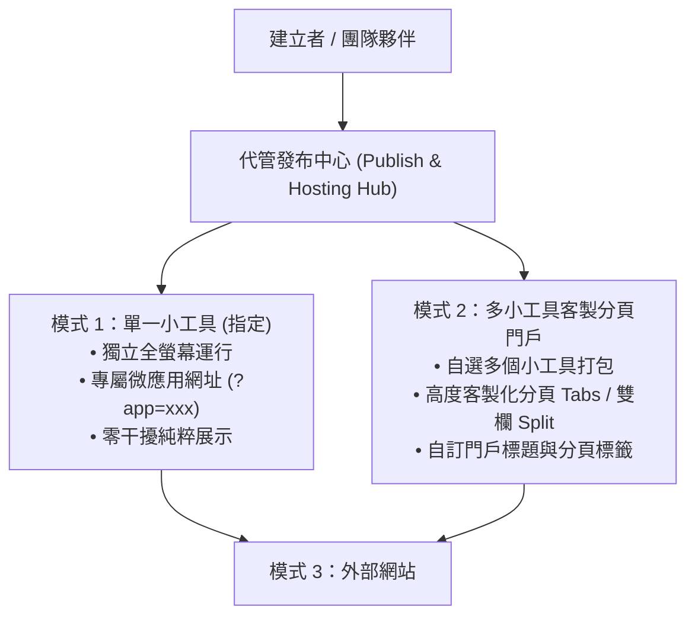

# 實作計畫：團隊協作工作站與三模式微應用代管發布平台

本計畫將「工具小本本」升級為兼具**「團隊共同協作」**與**「三模式微應用獨立代管發布」**的通用工作平台。

---

## 核心亮點：三種獨立代管與外部嵌入發布模式

### 1. 模式 1：單一小工具獨立代管（指定）
- **功能規格**：
  - 創作者指定任一小工具，一鍵生成專屬微應用網址：`https://o-o1112.github.io/tool-notebook/?host=HOST-XXXX`。
  - 訪客打開連結時，無任何側邊欄、導覽列或多餘卡片，**100% 滿版全螢幕獨立運行該小工具**。
  - 動態設定瀏覽器頁籤標題為該小工具名稱。
  - 右下角提供可折疊之微型浮動作者標章（一鍵複製、一鍵匯入自己空間）。

### 2. 模式 2：指定多種小工具 + 高度客製化分頁與分欄門戶
- **功能規格**：
  - 創作者可從空間中勾選「任意 2 個或多個小工具」打包發布。
  - 提供**「高度客製化分頁與分欄」**：
    - **分頁切換模式 (Tabs)**：頂部提供洗鍊現代的分頁標籤列，創作者可自訂各分頁標籤名稱與順序，使用者點擊流暢切換不同工具。
    - **雙欄對照模式 (Split Screen)**：支援左右並排同時操作兩個工具（例如左欄看數據、右欄做筆記）。
    - **精選貨架模式 (Compact Shelf)**：垂直卡片堆疊，自適應滾動。
  - 創作者可自訂發布門戶的主題色彩（溫潤紙質、極客夜墨、簡約素白）、門戶標題與副標題。

### 3. 模式 3：外部網站無縫嵌入代碼（支援模式 1 或模式 2）
- **功能規格**：
  - 發布面板提供一鍵「複製外部嵌入代碼」：
    - 支援為模式 1（單工具）或模式 2（多工具分頁門戶）生成專屬 `<iframe>` 嵌入語法。
    - 內建 `&embed=true` 參數，嵌入外部頁面（Notion、WordPress、GitHub Pages、公司官網、個人部落格）時自動去除任何外圍邊界與浮動標籤，呈現 100% 原生無縫融和外觀。
    - 提供響應式容器代碼、自訂預設寬度/高度與全螢幕放大按鈕。

---

## 團隊協作核心模組（同步整合）

1. **RBAC 角色型權限管理**：
   - 擁有者 (Owner)、協作者 (Editor)、檢視者 (Viewer)。
   - 解除既有單人死鎖，加入空間的團隊成員（預設為協作者）皆能共同新增、編輯小工具與排版。
   - 團隊管理面板：查看成員名單、切換成員角色、踢除成員或退出空間。
2. **操作「復原 (Undo / Restore)」機制**：
   - 刪除小工具時採用軟刪除，底部即時浮出「復原」Toast 按鈕，點擊可立即原地撤銷。
   - 空間回收歷史庫：集中檢視已刪除小工具並支援一鍵復原。
3. **空間「團隊對話 (Team Chat)」系統**：
   - 右側滑出式即時討論抽屜，團隊成員可在空間內傳送對話訊息、交接工作，並整合系統動態通知。

---

## 預計異動與新增檔案架構

### 後端與資料持久化層
- **Schema 擴充 (`src/server/db.js`, `worker/schema.sql`)**：
  - 新增 `hosted_shares` 表：
    - `id INTEGER PRIMARY KEY AUTOINCREMENT`
    - `share_code TEXT UNIQUE NOT NULL`
    - `user_id INTEGER NOT NULL`, `space_id INTEGER NOT NULL`
    - `mode TEXT NOT NULL` ('single' | 'multi')
    - `tool_ids TEXT NOT NULL` (JSON 陣列)
    - `title TEXT NOT NULL`, `custom_config TEXT DEFAULT '{}'` (自訂分頁名稱、排版、主題)
    - `is_active INTEGER DEFAULT 1`, `views INTEGER DEFAULT 0`, `created_at DATETIME`
  - `tools` 表：增加 `deleted_at DATETIME`, `created_by_user_id INTEGER`, `updated_by_user_id INTEGER`。
  - `space_members` 表：增加 `role TEXT DEFAULT 'editor'`。
  - 新增 `space_messages` 表（團隊對話）。
- **API 擴充 (`src/server/routes/spaces.js`, `worker/index.js`)**：
  - `POST /api/spaces/:id/hosted`：建立或更新代管發布（模式 1 或模式 2）。
  - `GET /api/hosted/:code`：免驗證公開讀取代管應用資料（支援 `?embed=true`）。
  - 團隊協作 API：`/members`, `/messages`, `/restore`, `/sync-status`。

### 前端介面與組件
- **全新組件 `src/client/components/HostedPortalView.jsx`**：
  - 依據 `mode` ('single' 或 'multi') 渲染獨立代管頁面。
  - 支援客製化分頁 (Tabs) 切換、雙欄對照 (Split) 與外部嵌入模式 (`embed=true`)。
- **全新組件 `src/client/components/PublishModal.jsx`**：
  - 視覺化精靈：模式 1（單工具）/ 模式 2（多工具自訂分頁）/ 模式 3（外部 `<iframe>` 代碼生成）。
  - 一鍵複製連結、手機向量 QR Code、外部嵌入代碼預覽。
- **全新組件 `src/client/components/TeamModal.jsx`**：
  - 成員列表、角色切換（協作者/檢視者）、踢除/退出、刪除復原庫。
- **全新組件 `src/client/components/TeamChatDrawer.jsx`**：
  - 右側滑出式團隊即時討論抽屜與動態廣播。
- **修改整合組件**：
  - `App.jsx`：路由識別 `?host=HOST-XXXX`，自動渲染 `HostedPortalView`；即時刪除復原 Toast。
  - `SpaceLayout.jsx`：頂部新增「發布代管中心」、「團隊成員」、「團隊對話」按鈕。
  - `ToolCard.jsx`：單卡選單新增「發布為獨立代管網站」快捷入口。

---

## 驗證指標
- [ ] 模式 1：點擊 `?host=HOST-XXXX` 可全螢幕單一運行該工具，零介面干擾。
- [ ] 模式 2：多工具發布能流暢切換客製化分頁標籤 (Tabs) 與雙欄對照 (Split)。
- [ ] 模式 3：複製生成的 `<iframe>` 嵌入語法在外部網頁運行完全原生無縫。
- [ ] 團隊夥伴（透過邀請碼加入）能自由新增、修改與排列小工具。
- [ ] 刪除小工具時彈出「復原」Toast，點擊立即撤銷還原。
- [ ] 團隊成員可在對話抽屜中發送訊息並即刻同步。
- [ ] 單元測試通過、`npm run build` 打包成功，代碼推播上線。
- [ ] 嚴格零表情符號 (STRICT ZERO EMOJIS) 與繁體中文 (台灣)。
